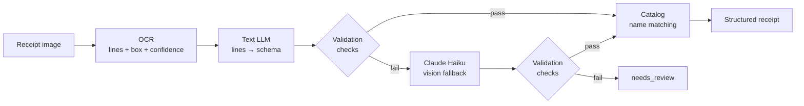

# receipt-extractor

Turns a photo of a Thai convenience-store receipt into structured,
validated data. 7-Eleven Thailand first.

> **Status: early.** The core library (schema, OCR interface, validation
> checks, catalog matching), the eval harness and a local OCR provider
> running the open OpenThai model exist and are tested. No LLM or API is
> wired up yet, no real receipt has been processed, and there are **no
> accuracy results yet**. See the [roadmap](#roadmap).

## What it does

A receipt photo goes in; a typed record comes out: store, branch, tax ID,
receipt number, date and time, line items, discounts, total, VAT, payment
and change. Each result says which checks it passed, how confident the OCR
was for each field, and whether a human should review it.

The design goal is not "an LLM reads a receipt". It is a pipeline whose
mistakes are **caught and measured**:

- A small open OCR model reads the text; a cheap text LLM only arranges
  it into a schema.
- Deterministic checks (arithmetic, formats, grounding in the OCR text)
  decide whether the result can be trusted.
- Only receipts that fail the checks are sent to a more expensive vision
  model. Receipts that still fail are flagged `needs_review`, not guessed.
- Every claim about accuracy, cost and latency comes from a reproducible
  eval on hand-labelled receipts.

## Architecture



| Stage | What | Where |
| --- | --- | --- |
| OCR | [`iapp/OpenThai2.0-OCR-Text`](https://huggingface.co/iapp/OpenThai2.0-OCR-Text) (Apache-2.0, ONNX, CPU). Open weights locally for evals; iApp hosted API in the cloud. Behind one interface. | `packages/core/ocr` (interface), `packages/ocr-openthai` (local provider) |
| Structuring | Cheap text LLM maps OCR lines to the schema. May not rewrite names. | `packages/core/structure` (interface only) |
| Validation | Arithmetic, date (Buddhist era → Gregorian), tax ID, grounding, OCR confidence. | `packages/core/validate` |
| Fallback | Claude Haiku with the original image, only when checks fail. | planned |
| Catalog | Product names learned from receipts; conservative fuzzy matching by Thai grapheme clusters. | `packages/core/catalog` |
| Evals | Hand-labelled, redacted receipts; metrics below. | `evals/` |

More detail: [docs/architecture.md](docs/architecture.md). Reasons behind
the main choices: [docs/decisions/](docs/decisions/).

## Results

No real results yet. This table will be filled only from files in
`evals/results/` produced on real, hand-labelled receipts.

| Metric | Easy | Hard | All |
| --- | --- | --- | --- |
| Receipts | – | – | – |
| Fully correct receipts | – | – | – |
| Total amount accuracy | – | – | – |
| Item amount accuracy | – | – | – |
| Raw item name CER (lower is better) | – | – | – |
| Catalog match accuracy | – | – | – |
| Fallback rate | – | – | – |
| needs_review rate | – | – | – |
| Wrong extractions caught by checks (recall) | – | – | – |
| Cost per receipt (USD, mean) | – | – | – |
| Latency per receipt (p50 / p95) | – | – | – |

Run configuration (to be filled with each result): OCR provider and
model, structuring model, prompt version, schema version, git commit.

Metric definitions and the label format: [evals/README.md](evals/README.md).

## Privacy

Receipts can carry personal data (member numbers, phone numbers, partial
card numbers, where and when you shop).

- **No unredacted receipt is ever committed.** Eval images are redacted
  by hand and stripped of metadata first; originals are git-ignored.
- **Third parties that will receive images** once those stages are built:
  - **iApp Technology** (Thailand) — hosted OCR API, when running in the
    cloud. Not used when OCR runs locally from the open weights.
  - **Anthropic** — Claude Haiku receives the original image only for
    receipts that fail validation (the vision fallback).
  - The text-structuring LLM provider (not chosen yet) receives OCR text,
    not the image.
- Nothing is sent anywhere today. The only network access is the one-time
  download of the public model files from Hugging Face during setup; OCR
  itself runs on your machine.
- OCR output is cached on disk in `.cache/ocr/` (git-ignored). It contains
  the text of whatever was read, so treat it like the images themselves.
- No secrets or model weights are in this repository.

Details: [docs/privacy.md](docs/privacy.md).

## Getting started

Requires [Bun](https://bun.sh).

```sh
bun install
bun run check     # lint + typecheck + tests
bun run eval      # eval harness on synthetic samples (no network, no keys)
```

### Local OCR (optional)

Runs the open OpenThai model on your machine through its official Python
runtime. Requires [uv](https://docs.astral.sh/uv/) and Python 3.11+.

```sh
bun run ocr:setup                    # venv + pinned deps + verified weights
bun run test:ocr                     # real model on a generated test image
bun run ocr <image-path>             # OCR one image: rows, confidence, dropped lines
bun run ocr <image-path> --json      # same, as JSON (with boxes)
bun run eval --ocr openthai-local    # synthetic eval with real OCR
```

`bun run ocr` reads one image on your machine and prints to the terminal
only. Keep private images in a git-ignored folder such as
`evals/dataset/private/`.

`ocr:setup` creates a virtual environment inside the repository
(`packages/ocr-openthai/python/.venv`), installs hash-locked dependencies
into it, and downloads a pinned model revision (about 4 MB) into `models/`,
verifying every file against the model repository's checksums. Nothing is
installed outside the repository. Details:
[packages/ocr-openthai/README.md](packages/ocr-openthai/README.md).

## Roadmap

- [x] **M0 — Foundations.** Monorepo, provisional schema, OCR interface
  with a fake provider, validation checks, catalog matching, eval harness
  on synthetic samples, CI.
- [ ] **M1 — Real receipts.** Confirm the 7-Eleven layout from physical
  receipts, finalise the schema, label a first redacted set (easy/hard).
- [ ] **M2 — Local OCR.** OpenThai 2.0 provider from the open weights
  (done: runs the official runtime in a Python worker, with a disk
  cache); first OCR-only numbers (CER) on real receipts (not done).
- [ ] **M3 — Structuring.** Text LLM structurer with versioned prompts;
  first end-to-end results table.
- [ ] **M4 — Fallback.** Claude Haiku vision fallback; measure fallback
  rate, cost, and what the checks catch and miss.
- [ ] **M5 — Catalog.** Learn the catalog from validated receipts;
  measure match accuracy.
- [ ] **M6 — API.** Elysia on Cloudflare Workers with R2, D1 + Drizzle
  and Queues; iApp hosted OCR provider.
- [ ] **M7 — Web.** Upload page with client-side redaction.
- [ ] **Optional — Self-hosted OCR** in a Cloudflare Container.

## License

[MIT](LICENSE). The OCR model is a separate work by iApp Technology under
Apache-2.0 and is not distributed with this repository.
